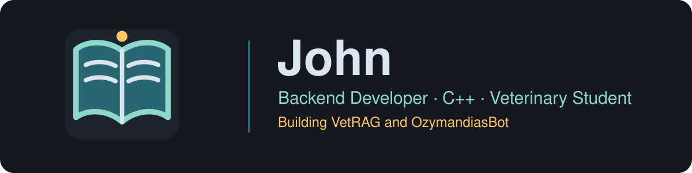
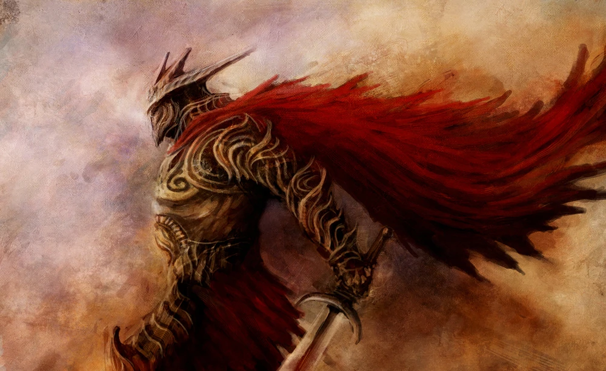
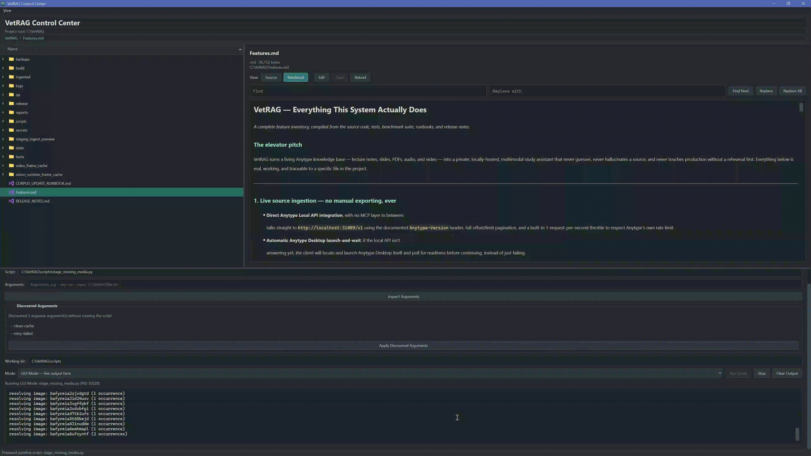

  

  

  
  
  
  

---

## 🧠 About Me

I'm a veterinary student who also builds backend software. My main language is C++, and I'm most interested in backend and systems work: how things run fast, stay correct, and keep working under load. I'm also curious about AI, and I've combined it with my studies in **VetRAG**, a study assistant for veterinary coursework.

  

> 💡 Most of my code is in private repositories, so this page is a summary, not a full portfolio.

---

## ⚙️ Interests

- ⚡ Backend development and systems programming in C++
- 🧩 Libraries and tooling, especially Boost
- 🤖 AI, including retrieval-augmented generation (RAG) and image and text generation
- 📱 Android software modding with ADB
- 🩺 Veterinary medicine

---

## 📊 GitHub Stats

  

---

## 📦 Projects

  

### 🩺 VetRAG: Veterinary Study Assistant

My largest project. A private, locally hosted, multimodal study assistant built from my Anytype knowledge base of lecture notes, slides, PDFs, audio, and video.

- 🔗 **Live ingestion** from Anytype's local API, with type-aware exports and linked media
- 🖼️ **Image understanding** with CPU captioning and an optional vision-model upgrade
- 🎙️ **Audio and video transcription** using Whisper, with CPU and GPU tiers
- 🎞️ **Video comprehension** through frame extraction and on-demand timestamp and range vision
- 📄 **Verified PDF search** with page-level hashing and cited answers
- 🧪 **Benchmarked and tested**, with about 45 structured test cases and unit tests
- 🛡️ **Staged deployment** with validation gates, backups, and a single write lock
- 🖥️ **Desktop control center** for browsing, running pipelines, and monitoring status

  

### 🏛️ OzymandiasBot: Discord Bot

A feature-rich Discord bot built in C++ with the DPP library.

| Feature | What it does |
| :--- | :--- |
| 🛡️ **Moderation** | Moderation tools, including automod |
| 🖼️ **Generation** | Image and text generation |
| 🎲 **Randomized outputs** | Randomized responses and results |
| 🎮 **Games** | Games users can play through the bot |
| 🔧 **Modding** | Tools for modding servers |

  

> 🔒 Both projects are private. OzymandiasBot is now archived.

---

## 💻 Setup

<b>Click to expand my build and devices</b>

**PC build**

| Component | Part |
| :--- | :--- |
| **CPU** | AMD Ryzen 9 9950X3D2 (16 cores, 4.3 GHz) |
| **GPU** | MSI GeForce RTX 5090 32 GB |
| **Motherboard** | Gigabyte X870E AORUS MASTER X3D |
| **Memory** | 128 GB DDR5-6400 |
| **Storage** | 3× Crucial T705 4 TB PCIe 5.0 NVMe, 2x Samsung 970 EVO Plus 1TB PCIE 3.0 NVMe|
| **Cooling** | Corsair iCUE LINK TITAN 360 RX LCD |
| **Case** | Fractal Design Meshify 2 |
| **Power** | SeaSonic PRIME TX-1600 (1600 W, 80+ Titanium) |
| **OS** | Windows 11 Pro |
| **Monitors** | MSI MPG 321URX (4K QD-OLED, 240 Hz), Asus VG248QG (1080p, 165 Hz), Acer Nitro KG271 (1080p, 180 Hz) |

**Peripherals and devices**

| Category | Device |
| :--- | :--- |
| **Keyboard** | Corsair K100 RGB |
| **Mouse** | Logitech G502 X Plus |
| **Headphones** | Sony WH-1000XM5 |
| **Webcam** | VIZOLINK W4DS |
| **Microphone** | Fifine AM8 |
| **Tablet** | GAOMON WH851 |
| **Phone** | OnePlus 12 |
| **Dev board** | LilyGO T-Embed CC |

---

## 🧰 Toolbox

  
  
  
  
  
  
  
  
  

---

  

  README last updated: 2026 · maintained by John

